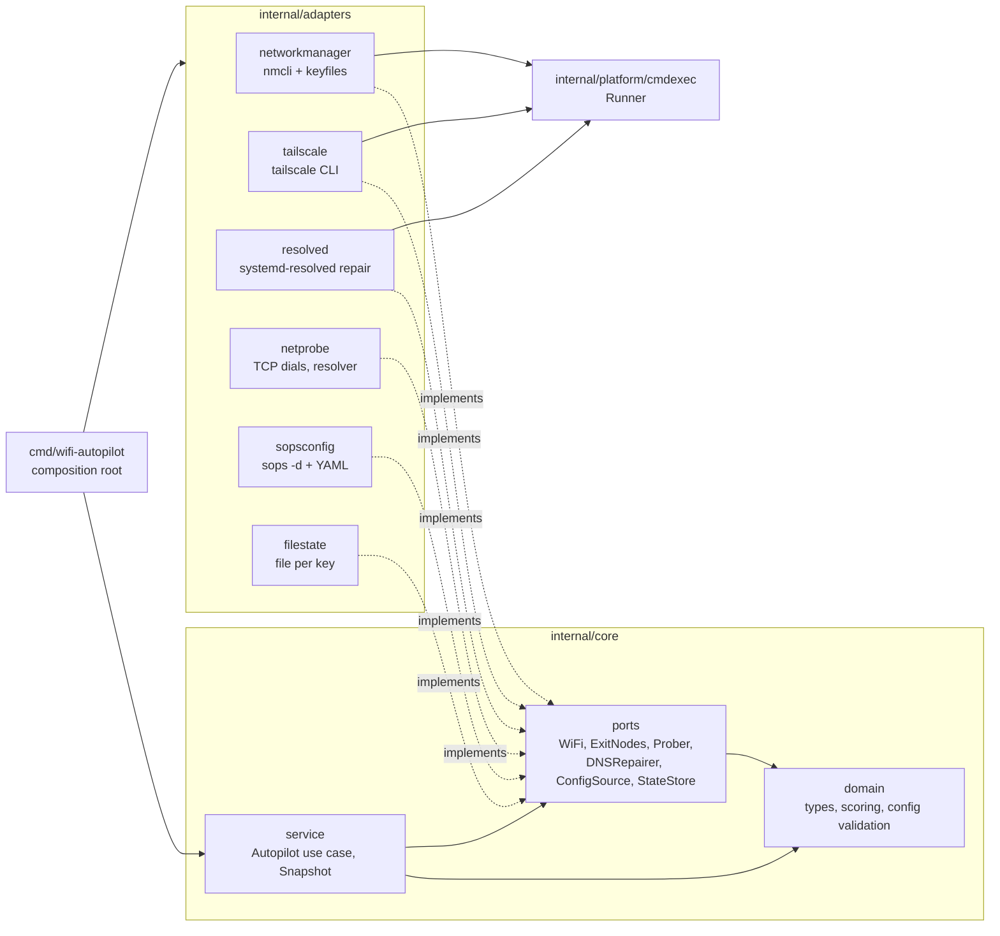

# wifi-autopilot

A small Linux daemon (systemd + NetworkManager) that keeps a laptop on the fastest Wi-Fi network it
is allowed to use, fails over a dead Tailscale exit node, and repairs DNS when name resolution breaks
while the internet itself is reachable.

## Why

It started with a real incident. A laptop lost DNS because the `systemd-resolvconf` shim was
installed while `systemd-resolved` was disabled, so Tailscale had nowhere to push its DNS
configuration; on top of that, the exit node in use dropped UDP DNS. TCP to `1.1.1.1` worked, every
hostname failed. Later the same exit node went offline and took all traffic with it. Each fix was a
handful of manual commands. This daemon detects those states and applies the fixes, and while it is
polling anyway it also picks the best access point among the configured networks.

## Features

- **Roaming by estimated throughput.** Every visible AP of a configured network is scored from scan
  data (no disconnecting to test). Switching uses hysteresis: a minimum gain (ratio and Mbps),
  confirmation over consecutive polls, a cooldown, an earlier roam when the current signal is weak,
  blacklisting of APs that connect but pass no traffic, and rollback to the previous AP if the new
  one does not come online.
- **Profile provisioning from encrypted config.** Networks with a password are written as
  NetworkManager keyfiles (root-only, mode 0600; passwords never appear in a process's argv). Stale
  profiles it created are removed; profiles it did not create are left alone. Networks without a
  password reuse a profile already saved on the machine.
- **sops + age config with hot reload.** Only `password` fields are encrypted, so SSIDs and tuning
  stay readable. Edits are picked up on the next poll; an invalid edit is rejected and the previous
  config is kept.
- **Tailscale exit-node failover.** When the exit node is offline or traffic stops flowing, it is
  cleared and its name is parked in `/var/lib/wifi-autopilot`, so a restart does not forget it. It
  is restored after it has been online for N consecutive polls, and cleared again if the restored
  route passes no traffic.
- **DNS self-repair.** When TCP-by-IP works but names do not resolve, steps run from least to most
  disruptive, stopping as soon as DNS works:
  1. enable `systemd-resolved`
  2. symlink `/etc/resolv.conf` to `/run/systemd/resolve/stub-resolv.conf` (a regular file is backed
     up to `/etc/resolv.conf.wifi-autopilot.bak`)
  3. `resolvectl flush-caches`
  4. restart NetworkManager and `tailscaled` (rate-limited by `heavy_cooldown`)
- **`-once`** prints the ranking table and connectivity status; **`-dry-run`** logs every decision
  without acting on it.

## Architecture

Hexagonal (ports and adapters). The core has no I/O and imports no adapter; adapters wrap CLIs and
the filesystem; `cmd/wifi-autopilot` is the only place where concrete types are wired together.



`internal/core/service` is tested against in-memory fakes of every port; adapters are tested
against canned CLI output through the `cmdexec.Runner` function type.

### Scoring model

```
est_mbps = PHY × 0.65 × signal_efficiency / congestion × weight
```

- **PHY**: best rate a 2x2 Wi-Fi 5 client (modelled on the Intel 9560) can negotiate: 802.11n on
  2.4 GHz (144 / 300 Mbps at 20 / 40 MHz), 802.11ac on 5 GHz (173 / 400 / 867 / 1733 Mbps at
  20 / 40 / 80 / 160 MHz), capped by the AP's advertised rate.
- **0.65**: typical MAC efficiency, real TCP throughput relative to PHY rate.
- **signal_efficiency**: piecewise-linear curve from dBm to the fraction of the PHY rate a 2x2
  client sustains (1.0 at -50 dBm down to 0 at -88 dBm).
- **congestion**: `1 + 0.3 × load`, where each other AP in the same band on an overlapping channel
  adds up to 1 depending on its signal. Virtual APs on the same radio (guest SSIDs: same channel,
  same trailing BSSID octets) do not count.
- **weight**: per-network preference from the config (e.g. 0.3 for a metered hotspot).

### Poll loop

Every `poll_interval`, in this order:

1. Reload the config if the file changed (and re-sync profiles).
2. Probe the internet with TCP dials to fixed IPs.
3. Exit-node failover or restore; re-probe if routing changed.
4. If online, probe DNS and run the repair steps after `failures_before_heal` consecutive failures.
5. Roam, unless ethernet is up and `skip_when_wired` is set.

## Install

Requirements: Linux with NetworkManager, `sops` and `age` (for `age-keygen`), Go 1.26 to build.
Tailscale and systemd-resolved are optional; the related features stay idle without them.

```sh
make build          # as your user
sudo ./install.sh   # binary, systemd unit, age key and .sops.yaml under /etc/wifi-autopilot
```

`install.sh` creates `/etc/wifi-autopilot/age.key` (back it up; without it the config cannot be
decrypted) and `/etc/wifi-autopilot/.sops.yaml` from `deploy/sops.yaml.example`, which encrypts
only fields matching `^password$`. Then write and encrypt the config:

```sh
sudo cp deploy/config.example.yaml /etc/wifi-autopilot/config.sops.yaml
sudoedit /etc/wifi-autopilot/config.sops.yaml          # your networks and passwords
(cd /etc/wifi-autopilot && sudo sops encrypt --in-place config.sops.yaml)
sudo SOPS_AGE_KEY_FILE=/etc/wifi-autopilot/age.key wifi-autopilot -config /etc/wifi-autopilot/config.sops.yaml -once
sudo systemctl enable --now wifi-autopilot
```

Edit later with `sudo SOPS_AGE_KEY_FILE=/etc/wifi-autopilot/age.key sops edit
/etc/wifi-autopilot/config.sops.yaml`; the service reloads it on its own. Logs:
`journalctl -fu wifi-autopilot` (or `make logs`).

[`deploy/config.example.yaml`](deploy/config.example.yaml) documents every option with its default.
Only `networks` is required. An unencrypted YAML file also works (it is read as-is when it has no
`sops` metadata), which is handy for testing.

## CLI

| Flag | Default | Description |
| --- | --- | --- |
| `-config` | `/etc/wifi-autopilot/config.sops.yaml` | config file (plain or sops-encrypted YAML) |
| `-state-dir` | `/var/lib/wifi-autopilot` | where small runtime state is persisted |
| `-once` | `false` | print the current ranking and connectivity, then exit (implies dry run) |
| `-dry-run` | `false` | log decisions without switching networks, writing profiles or repairing DNS |
| `-debug` | `false` | verbose logging |

## Testing

```sh
make lint    # gofmt + go vet
make test    # go test -race ./...
```

The `resolved` adapter tests use symlinks and are skipped on Windows. CI runs lint, test and build
on Ubuntu.

## Limitations

- Drives NetworkManager through `nmcli`; other network stacks (iwd alone, wpa_supplicant,
  systemd-networkd) are not supported.
- The PHY model assumes a 2x2 Wi-Fi 5 client. 6 GHz APs are recognised but scored with the 5 GHz
  table, and Wi-Fi 6/7 gains are not modelled.
- Throughput is estimated from scan data, not measured with live speed tests.
- DNS repair assumes a systemd-resolved setup.
- Runs as root: it writes NetworkManager profiles, manages systemd units and changes Tailscale
  preferences.

## License

MIT
